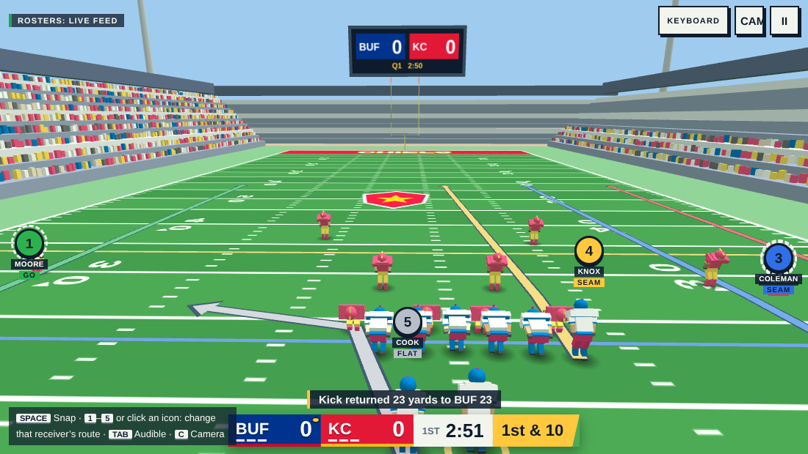

### Hi, I'm Noah 👋

I'm repositioning into **Marketing Ops / RevOps / GTM Engineering** — and building the tools I wish existed along the way.

- 🔭 Building **[my-edge](https://github.com/NoahSA11/my-edge)** — a personal AI-skills command center for the GTM Engineering job search — and small productivity tools like **[chrome-todo-timer](https://github.com/NoahSA11/chrome-todo-timer)**.
- 🌱 Learning n8n, Clay, and workflow automation for GTM/RevOps use cases.
- 🤖 I build tools to solve my own problems first, then share them.
- 📍 Based in Israel.

---

### 🚀 Shipped

**[The Afterschool Club](https://afterschool-club.vercel.app)** — a Duolingo-style English reading practice app for Israeli elementary school kids. Hebrew UI, English words, in-browser speech recognition (no server, no API cost) so kids get instant pronunciation feedback from an animated mascot. Built end-to-end (React, Supabase, on-device Whisper via Transformers.js) and now in real use. Source is private — it'''s whitelabeled for a live teaching business.

**[Shvil · שביל](https://noahsa11.github.io/shvil/)** — a Duolingo-style game for learning the Chumash (Five Books of Moses) and Rashi, Hebrew-first with an English toggle. Every pasuk, translation and Rashi comes from Sefaria data snapshotted at build time, and every generated question is audited against that data in CI. Works fully offline as a PWA, no accounts or tracking. Vanilla TypeScript + Vite. [Source](https://github.com/NoahSA11/shvil)

**[Gridiron Sunday](https://noahsa11.github.io/Gridiron-Sunday/)** — a 3D broadcast-style American football game that runs in the browser on phones and computers, with current rosters for all 32 NFL teams (rebuilt daily by GitHub Actions). Quick Game or a 6-week Season with playoffs, 17 offensive plays and 14 defenses, hot routes and audibles, plus touch, keyboard and gamepad controls. Three.js, plain JavaScript, no build step. [Source](https://github.com/NoahSA11/Gridiron-Sunday)

