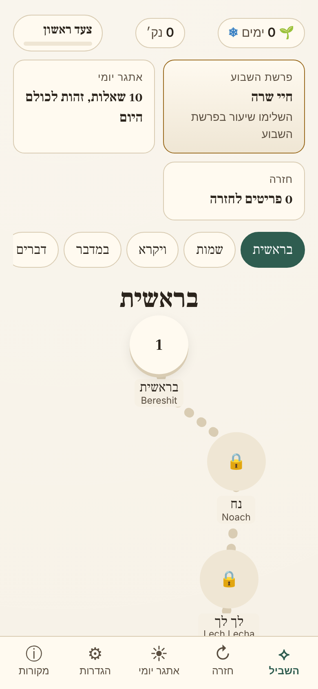
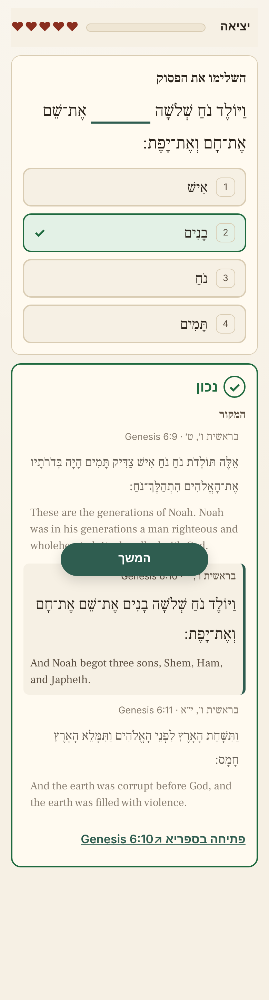

# שביל · Shvil

A mobile-first, offline-capable learning game for the **Chumash**, with a Hebrew-first (RTL) interface and an English toggle. All five books, all 54 parshiyot, Hebrew with nikud (cantillation as a toggle), the JPS 1917 English translation, and Rashi linked to each pasuk.

 

**Accuracy rule:** every word of Torah, translation and Rashi shown in the app comes from **[Sefaria](https://www.sefaria.org)** data, fetched at build time by a script and committed as snapshots in `data/raw/`. Nothing is typed from memory. Questions are generated by deterministic code over those snapshots, and every generated question is re-checked against the raw snapshots by `scripts/audit-questions.ts`, which fails the build on any violation.

## Run it

```bash
cd shvil
npm ci
npm run content     # data/raw → public/content (books, question banks, calendar)
npm run dev         # http://localhost:5173
```

Full check (what CI runs):

```bash
npm run typecheck && npm run content && npm test && npm run audit && npm run build
```

With a preview server running (`npm run preview`, port 4173):

```bash
npm run e2e          # full lesson via clicks, mid-lesson reloads, offline mode
npm run screenshots  # 390×844 and 1280×800 screenshots → test-results/shots/
```

The GitHub Actions workflow (`.github/workflows/shvil.yml` at the repo root) runs the checks and deploys `dist/` to GitHub Pages. Enable Pages with source “GitHub Actions” in the repository settings.

## What's in it

- **Path map** per book: a winding path of parshiyot, unlocking in order, with a mastery ring per parsha and a placement quiz (8 questions, 6 correct) to skip ahead.
- **Lessons**: a “learn first” card (the parsha's first 4 pesukim with translation and its first Rashi), then 10 questions mixing:
  1. **Finish the pasuk** (cloze; distractors from neighbouring pesukim or the same pasuk, verified not to fit)
  2. **Order the pesukim** (3–5 consecutive pesukim)
  3. **Where is this from?** (book / parsha / perek; only distinctive pesukim, repeated formulas excluded)
  4. **Rashi match** (a real Rashi comment; which pasuk is it attached to?)
  5. **First / last words** of a parsha or perek
- Feedback after **every** answer, right or wrong: the pasuk in context (previous/next pasuk), translation, Rashi where relevant, the reference (`Genesis 6:10`) and a link to sefaria.org. Correct/incorrect is shown with icon + text + border style, never colour alone.
- **XP, levels, daily streak with one freeze, 5 gentle hearts per lesson.**
- **Spaced repetition** (Leitner boxes, 1/2/4/8/16/32 days); **Review** builds a session from due items.
- **Daily Challenge**: 10 mixed questions seeded from the local date, shareable emoji result.
- **Parsha of the Week** quest, from a calendar table computed at build time (Israel or Diaspora).
- Settings: language, cantillation, divine names as written or substituted (ה׳ / אלקים, display only), translation on/off, calendar. Progress export/import as JSON.
- No accounts, no backend, no analytics. Progress lives in `localStorage` (versioned schema with migrations).

## How content is built and audited

```
data/raw/torah/<Book>/base.he.json         Sefaria version JSON, as downloaded
                      translation.en.json
                      commentary.he.json   Rashi on <Book>
                      commentary.en.json
                      schema.json          Sefaria index (Parasha alt structure)
data/manifest.json                         version titles, licences, URLs, sha256, fetch dates
```

1. `scripts/fetch-sefaria.ts` downloads each version listed in `content.config.ts` from the official Sefaria-Export dataset (sequential, 1.5 s apart, descriptive User-Agent, cached; `--force` to refetch). It reads each version's `license` field and **refuses** any version whose licence is missing or not in the allow-list (Public Domain, CC0, CC-BY).
2. `scripts/build-content.ts` turns the snapshots into per-book JSON and a deterministic question bank per book (`src/engine/questions/*`, seeded PRNG), plus the weekly parsha table.
3. `scripts/audit-questions.ts` reads `data/raw/` **directly** (not the processed content) and validates every shipped question: the answer is present at the stated ref and token; distractors are real words from the stated neighbouring pesukim, differ from the answer and do not form any real pasuk; order questions are truly consecutive and their shuffle is not the answer; “where” answers are the actual book/parsha/perek and the pasuk is unique; Rashi comments match the raw comment attached to that ref and distractor pesukim do not carry the same comment; first/last words equal the raw words at the edge. It also checks shipped verse text is byte-identical to the raw text and parsha ranges match the raw schema. `tests/audit.test.ts` injects bad questions of each kind and proves the audit rejects them.

Current result: **4,073 questions audited, 0 violations** (cloze 1,921 · order 432 · where 648 · rashi 756 · first/last 316).

## Data size

| | raw | gzip |
|---|---|---|
| `data/raw/` (committed snapshots) | 8.2 MB | — |
| Shipped content, 5 books + banks + calendar | 9.4 MB | 2.8 MB |
| App code (JS + CSS) | 54 KB | 19 KB |
| Fonts (Hebrew + Latin woff2) | 44 KB | — |

The first load fetches the app shell, the index and the book you open (~0.7 MB gzipped for Genesis + its bank). The service worker then caches the other books in the background, so everything works offline.

## Licences and credits

All texts via **Sefaria** (sefaria.org), Sefaria-Export dataset (export of 2026-11-01). Licence values are read from each version's own `license` field.

| Text | Sefaria version | Licence | Source |
|---|---|---|---|
| Torah, Hebrew (nikud + te'amim) | Tanach with Ta'amei Hamikra | Public Domain | tanach.us (Westminster Leningrad Codex) |
| Torah, English | The Holy Scriptures: A New Translation (JPS 1917) | Public Domain | Open Siddur Project |
| Rashi, Hebrew (Genesis–Leviticus, Deuteronomy) | Pentateuch with Rashi's commentary by M. Rosenbaum and A.M. Silbermann, 1929-1934 | Public Domain | National Library of Israel |
| Rashi, Hebrew (Numbers) | Pentateuch with Rashi's commentary by M. Rosenbaum and A.M. Silbermann -- corrected vocalization | Public Domain | National Library of Israel |
| Rashi, English | Pentateuch with Rashi's commentary by M. Rosenbaum and A.M. Silbermann, 1929-1934 | Public Domain | National Library of Israel |

- Font: Frank Ruhl Libre, SIL Open Font License 1.1 (self-hosted via `@fontsource`).
- Weekly parsha table: computed at build time with `@hebcal/core` (GPL-2.0-or-later); only its output is shipped. This project is licensed GPL-2.0-or-later.
- Personal, non-commercial project. The in-app **Credits** screen lists the same table from `data/manifest.json`.

## Add a book (or a corpus)

1. Add a `BookSpec` (or a whole `CorpusSpec`) to `content.config.ts`: Sefaria title, export path, version titles, accepted licences, and the alt structure for lessons (e.g. `Parasha`).
2. `npm run fetch` → new snapshots in `data/raw/` and entries in `data/manifest.json` (the fetch fails if a licence is unknown).
3. `npm run content && npm run audit && npm test`, then commit the snapshots.

Generators assume a `[chapter][verse]` text and a commentary keyed `[chapter][verse][comment]`; see `NEXT.md` for what Nach and Mishnah would need.
